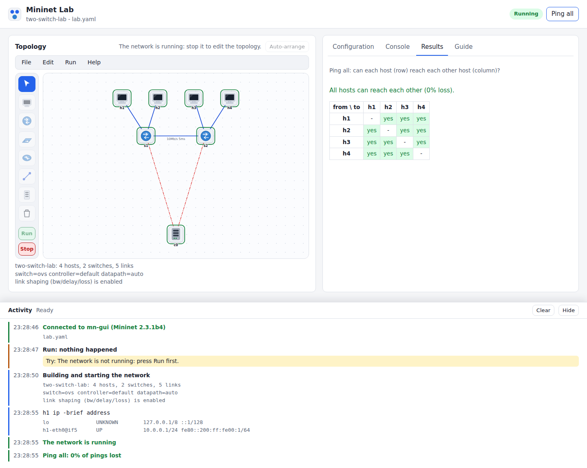
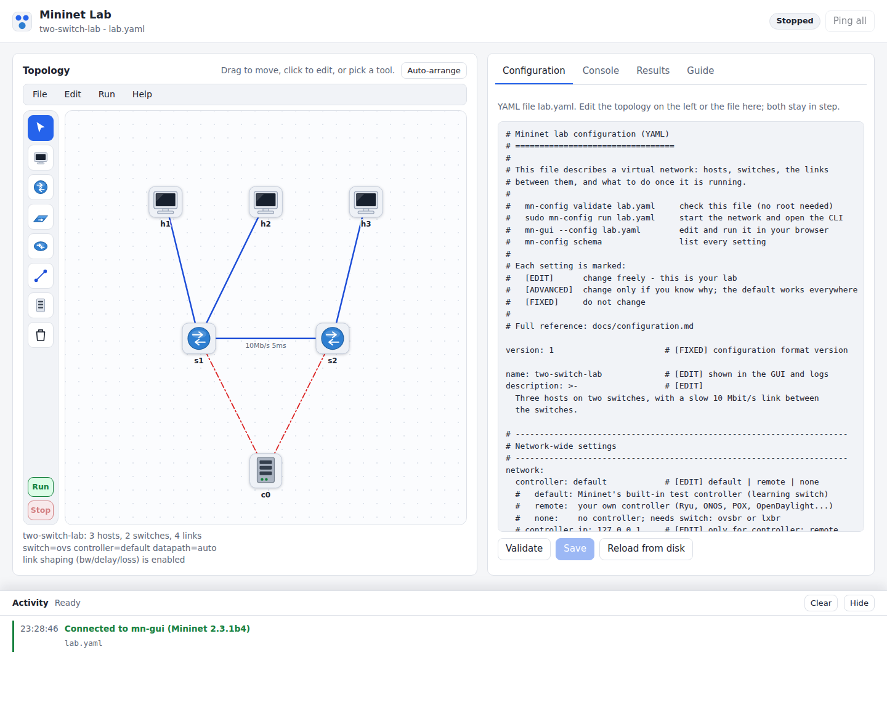
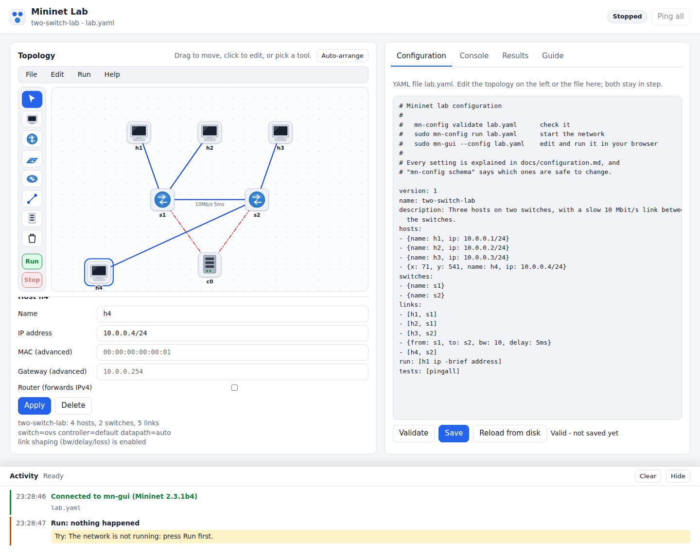
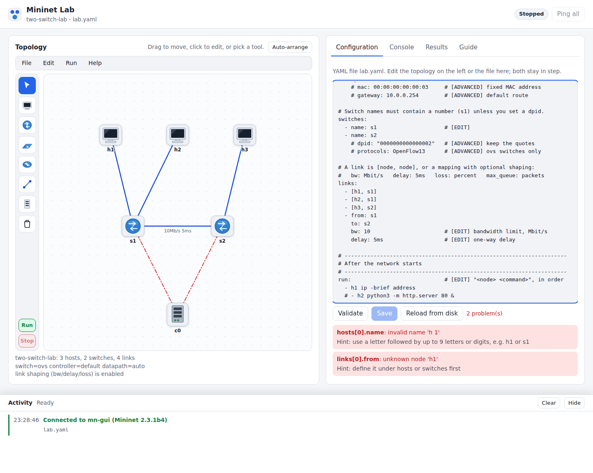
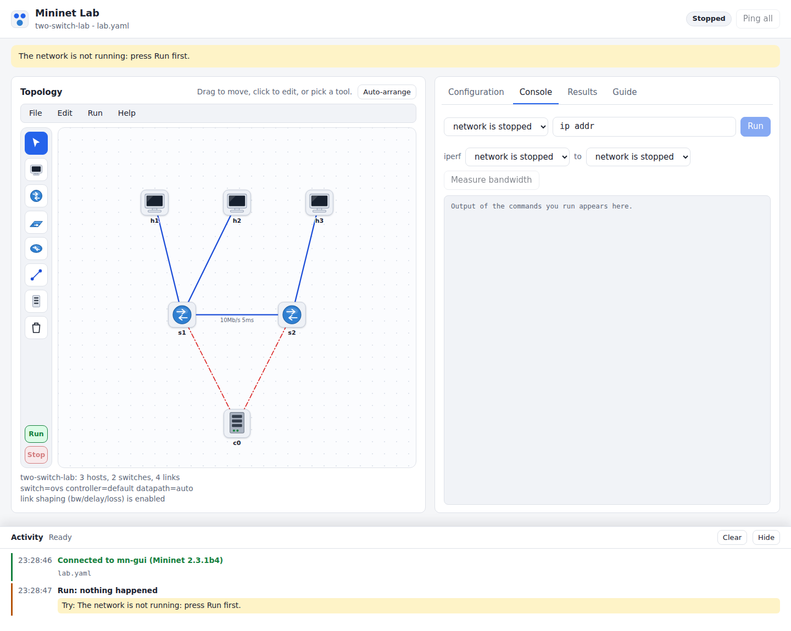

<h1 align="center">Mininet</h1>

<p align="center">
  A network of Linux hosts and OpenFlow switches, running on one machine.
</p>

<p align="center">
  <a href="https://github.com/Mangesh-Bhattacharya/mininet/actions/workflows/tests.yml"></a>
  <a href="https://github.com/Mangesh-Bhattacharya/mininet/actions/workflows/install-matrix.yml"></a>
  <a href="https://github.com/Mangesh-Bhattacharya/mininet/actions/workflows/docker.yml"></a>
  <a href="https://github.com/Mangesh-Bhattacharya/mininet/actions/workflows/security-audit.yml"></a>
  <a href="LICENSE"></a>
</p>

<p align="center">
  <picture>
    <source media="(prefers-color-scheme: dark)" srcset="docs/images/gui-pingall-dark.png">
    
  </picture>
</p>

Each host is a Linux network namespace with its own interfaces and
routing table, so `ping`, `tcpdump` and `iperf` behave the way they do
on separate machines. A small network starts in about a second and
leaves nothing behind when you quit. It is used for teaching
networking, for trying SDN and OpenFlow ideas, and for class labs.

`mn`, the Python API and existing tutorials are unchanged here. What
this fork adds: it installs on Windows and macOS as well as Linux, it
has a browser GUI, a lab is a file you can check into git, and students
do not need an administrator account.

## Install

Docker, on any machine. Install
[Docker Desktop](https://docs.docker.com/get-docker/), then:

```bash
docker run --rm -it --privileged ghcr.io/mangesh-bhattacharya/mininet
```

```text
root@mininet:/workspace# mn --test pingall
*** Results: 0% dropped (2/2 received)
```

Ubuntu 22.04, 24.04, 26.04 or Debian 12, 13:

```bash
git clone https://github.com/Mangesh-Bhattacharya/mininet.git
cd mininet
util/install.sh -nv
sudo mn --test pingall
```

On Windows, use the Docker command above, or
`.\scripts\mininet-docker.ps1 -Gui` from a clone. For the full thing,
install Ubuntu under WSL 2 and follow the Linux steps
([docs/install/windows.md](docs/install/windows.md)). On macOS the same
Docker command works on Intel and Apple Silicon, or use a VM
([docs/install/macos.md](docs/install/macos.md)). In a clone,
`vagrant up && vagrant ssh` works with VirtualBox, VMware, Parallels,
Hyper-V and libvirt.

`mn-doctor` reports what is missing and prints a command that will
work, including on Windows and macOS where Mininet itself cannot run.

## A first lab

A lab is one file:

```bash
mn-config init --lang yaml -o lab.yaml
sudo mn-gui --config lab.yaml
```

`mn-gui` prints a URL containing an access token. Open it. The topology
is on the left, the file on the right, and editing either one updates
the other.

<picture>
  <source media="(prefers-color-scheme: dark)" srcset="docs/images/gui-overview-dark.png">
  
</picture>

The palette is MiniEdit's: select, host, switch, legacy switch, legacy
router, link, controller, delete. Drop a device on the canvas, click two
devices to link them, set addresses and link speeds underneath. Changes
go into the lab file as you make them.



The file is checked while you type. Problems are listed with a hint
each, and Save stays off until they are fixed.

<picture>
  <source media="(prefers-color-scheme: dark)" srcset="docs/images/gui-validation-dark.png">
  
</picture>

Run starts the network. Ping all fills in a matrix of which host reaches
which, and the Console tab gives you a shell on any host or an iperf
measurement between two of them.

The strip along the bottom is the activity log: every command the lab
ran, its output, and a suggested fix for each error. Pressing a button
that cannot work says why instead of doing nothing, and the reason
depends on the machine. On Windows it points at WSL 2 or Docker rather
than suggesting `sudo`, which would not help there.

<picture>
  <source media="(prefers-color-scheme: dark)" srcset="docs/images/gui-activity-dark.png">
  
</picture>

The GUI listens on `127.0.0.1` only, requires the token it printed, and
loads nothing from the internet. [docs/gui.md](docs/gui.md) covers the
rest, including reaching it over SSH on a VM.

## Lab files

The file the GUI edits is plain text, and the command line does the same
work:

```bash
mn-config validate lab.yaml     # check it, no root needed
sudo mn-config run lab.yaml     # start it, run its tests, open the CLI
```

```yaml
version: 1                  # [FIXED]    don't change
name: two-switch-lab        # [EDIT]     your lab
network:
  controller: default       # [EDIT]     default | remote | none
  datapath: auto            # [ADVANCED] leave on auto
hosts:
  - { name: h1, ip: 10.0.0.1/24 }
  - { name: h2, ip: 10.0.0.2/24 }
switches: [ { name: s1 }, { name: s2 } ]
links:
  - [h1, s1]
  - [h2, s2]
  - { from: s1, to: s2, bw: 10, delay: 5ms }   # 10 Mbit/s, 5 ms
tests: [pingall]
```

Settings are marked `[EDIT]`, `[ADVANCED]` or `[FIXED]`, so it is clear
which ones are safe to change. Problems come back together, with hints:

```text
$ mn-config validate lab.yaml
Configuration problems:
  - netwrok: unknown setting
    hint: did you mean "network"?
  - links[2].to: unknown node 's9'
    hint: define it under hosts or switches first
```

The same lab can be written in JSON, Python, C, C++, C#, Java, Ruby or
COBOL (`mn-config init --lang java`). They produce the same network and
pass the same checks; program configs are compiled and run as you, never
as root. `run` exits non-zero when a test fails, so `mn-config run
lab.yaml --no-cli` works in a script or an autograder. Full reference:
[docs/configuration.md](docs/configuration.md).

Writing and checking a lab does not need Linux. `pip install ".[yaml]"`
on Windows or macOS installs `mn-config` and `mn-gui`; the GUI opens in
edit-only mode and says where to run the finished lab.

## Running without root

Mininet needs root to create network namespaces. The person using it
does not:

```bash
sudo util/nonroot-setup.sh --user alice   # once, by an admin
mn --test pingall                         # from then on, as alice
```

`util/install.sh` offers this at the end of an install, or run it later
with `util/install.sh -u`. It adds the user to a `mininet` group and one
`sudoers` rule, and the commands re-run themselves as root. This does
grant that user root by way of Mininet, much as the `docker` group does.
See [docs/install/without-sudo.md](docs/install/without-sudo.md) for the
trade-off and how to undo it.

## Command line

```bash
sudo mn                                           # 2 hosts, 1 switch, interactive CLI
sudo mn --topo tree,depth=2,fanout=3 --test pingall
sudo mn --link tc,bw=10,delay=5ms                 # shaped links
mininet> h1 ping -c3 h2
mininet> iperf h1 h2
```

This is unchanged from upstream, so tutorials written for Mininet work
as written. [docs/getting-started.md](docs/getting-started.md) is a
starting point.

## Also included

MiniEdit, the original desktop editor, in `examples/`. A Docker image
(`latest`, or `full` for the Java, C# and COBOL toolchains). Launcher
scripts for Linux, macOS and Windows in `scripts/`. A `Vagrantfile` and
cloud-init for VMs. A `debian/` directory for building a `.deb`.

## Troubleshooting

Start with `mn-doctor`. If that does not explain it, see
[docs/troubleshooting.md](docs/troubleshooting.md), then open an issue
with the output of `mn-doctor --json`.

Tested on every change and again weekly: Ubuntu 22.04/24.04/26.04 and
Debian 12/13 from clean containers, the Docker image on amd64 and arm64,
the GUI driven by a real browser in light and dark mode, all nine config
languages, the Debian package, the OpenFlow reference switch on gcc 13
and 15, the Windows and macOS launchers, and Python 3.9 through 3.14.

## Security

Images are rebuilt each Monday with current Ubuntu security updates, and
Dependabot proposes updates as they appear; one whose tests pass merges
itself. On the 1st and 15th of each month a longer audit runs ClamAV
over the source and the published image, OSV against the dependencies,
gitleaks over the git history, and Trivy against the image. Each check
is tied to the [MITRE ATT&CK](docs/security/attack-coverage.md)
technique it defends against, and a finding opens an issue.

An image with a fixable high or critical vulnerability is not published.
Published images are signed with cosign and carry an SBOM and build
provenance:

```bash
cosign verify ghcr.io/mangesh-bhattacharya/mininet:latest \
  --certificate-identity-regexp '^https://github.com/Mangesh-Bhattacharya/mininet/\.github/workflows/docker\.yml@' \
  --certificate-oidc-issuer https://token.actions.githubusercontent.com
```

Mininet needs root and `--privileged`, so run labs on a lab machine, a
VM or a container. Report vulnerabilities privately:
[SECURITY.md](SECURITY.md).

## Documentation

Install: [Linux](docs/install/linux.md) ·
[Windows](docs/install/windows.md) · [macOS](docs/install/macos.md) ·
[Docker](docs/install/docker.md) ·
[Virtual machines](docs/install/virtual-machines.md) ·
[Without sudo](docs/install/without-sudo.md)

Use: [Getting started](docs/getting-started.md) ·
[Lab files](docs/configuration.md) · [Browser GUI](docs/gui.md) ·
[Troubleshooting](docs/troubleshooting.md)

Other: [Security policy](SECURITY.md) ·
[ATT&CK coverage](docs/security/attack-coverage.md) ·
[Mininet-AI notes](docs/research/mininet-ai.md) ·
[mininet.org](http://mininet.org) ·
[Upstream walkthrough](http://mininet.org/walkthrough/)

## Credits

Mininet is the work of Bob Lantz, Brandon Heller, Nikhil Handigol and
the [Mininet contributors](CONTRIBUTORS). The installers, Docker image,
VM tooling, `mn-doctor`, `mn-config`, `mn-gui`, documentation and
security automation in this edition are maintained by
[Mangesh Bhattacharya](https://github.com/Mangesh-Bhattacharya). General
fixes go upstream as well, such as
[mininet/mininet#1256](https://github.com/mininet/mininet/pull/1256).
Everything is under the [BSD 3-Clause License](LICENSE).

Pull requests are welcome, particularly for an install that did not work
on your machine.
