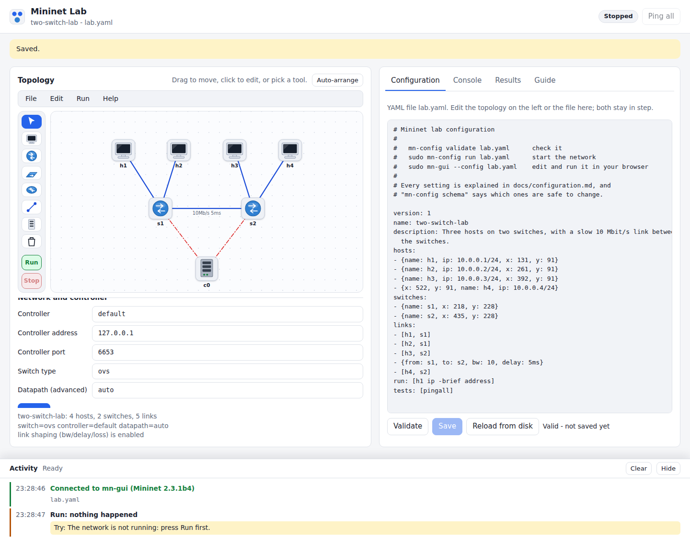
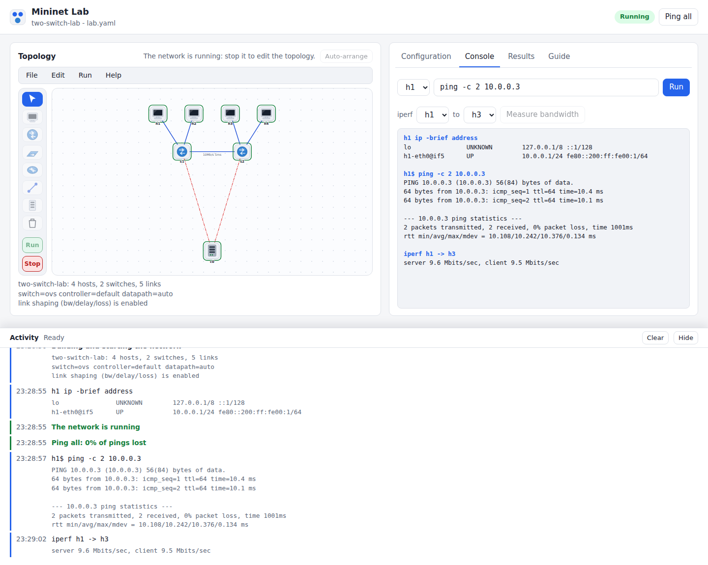
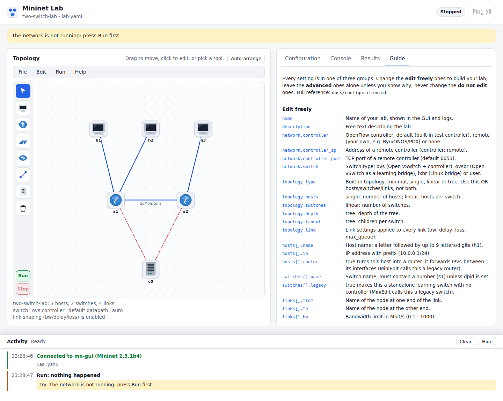

<h1 align="center">Mininet</h1>

<p align="center">
  <strong>A whole computer network on your laptop.<br>
  Draw it in your browser, run it for real, and see what happens.</strong>
</p>

<p align="center">
  <a href="#install-it">Install</a> ·
  <a href="#take-the-tour">Tour</a> ·
  <a href="#write-labs-in-the-language-you-know">Lab files</a> ·
  <a href="#use-it-without-an-administrator-account">No admin needed</a> ·
  <a href="#security-and-updates">Security</a> ·
  <a href="docs/getting-started.md">Docs</a>
</p>

<p align="center">
  <a href="https://github.com/Mangesh-Bhattacharya/mininet/actions/workflows/tests.yml"></a>
  <a href="https://github.com/Mangesh-Bhattacharya/mininet/actions/workflows/install-matrix.yml"></a>
  <a href="https://github.com/Mangesh-Bhattacharya/mininet/actions/workflows/docker.yml"></a>
  <a href="https://github.com/Mangesh-Bhattacharya/mininet/actions/workflows/security.yml"></a>
  <a href="https://github.com/Mangesh-Bhattacharya/mininet/actions/workflows/security-audit.yml"></a>
  <a href="LICENSE"></a>
</p>

<p align="center">
  <picture>
    <source media="(prefers-color-scheme: dark)" srcset="docs/images/gui-pingall-dark.png">
    
  </picture>
</p>

Mininet builds a real network — hosts, switches, links and an SDN
controller — out of Linux network namespaces, in about a second, on one
machine. The packets are real, the commands are the ones you would type
on a real box, and when you are done it disappears without trace.

It is the standard tool for learning and prototyping Software-Defined
Networking and OpenFlow. **This edition makes it something you can
install on the machine you already own**, in one command, and use
without reading a manual first.

|   | |
|---|---|
| 🖥️ **Works on your machine** | Windows, macOS, Linux, a VM, or one `docker run`. Intel and Apple Silicon. |
| 🎨 **Draw the network** | A browser editor with MiniEdit's look: drag devices, click two to link them, press Run. |
| 📄 **Or write it down** | Lab files in YAML, JSON, Python, C, C++, C#, Java, Ruby or COBOL. |
| 🙋 **No admin account** | One setup command and students run labs without ever typing `sudo`. |
| 🔎 **Tells you what went wrong** | Every error comes with a line saying what to try next. |
| 🔐 **Looked after** | Signed images, weekly patches, a malware and MITRE ATT&CK audit every two weeks. |

Everything upstream still works: the `mn` command, the Python API and
every tutorial written for [mininet/mininet](https://github.com/mininet/mininet)
2.3.1b4 behave exactly as before.

---

## Install it

### Any computer, with Docker — nothing else to install

Works on Windows, macOS and Linux, Intel and ARM. Install
[Docker Desktop](https://docs.docker.com/get-docker/) (or OrbStack /
Colima on macOS, Docker Engine on Linux), then:

```bash
docker run --rm -it --privileged ghcr.io/mangesh-bhattacharya/mininet
```

```text
root@mininet:/workspace# mn --test pingall
*** Results: 0% dropped (2/2 received)
```

That is a working network. To get **the browser GUI**, publish its port
to your own machine and open the `http://localhost:8080/#token=...` link
it prints:

```bash
docker run --rm -it --privileged -p 127.0.0.1:8080:8080 -v "$PWD:/workspace" \
  ghcr.io/mangesh-bhattacharya/mininet mn-gui --config /workspace/lab.yaml
```

`lab.yaml` appears in the folder you ran it from, ready to edit. On
Windows PowerShell use `${PWD}` and keep it on one line — or just run
`.\scripts\mininet-docker.ps1 -Gui` from a clone, which does all of the
above for you. More: [docs/install/docker.md](docs/install/docker.md).

### Ubuntu or Debian — install it properly

Ubuntu 22.04, 24.04 and 26.04; Debian 12 and 13:

```bash
git clone https://github.com/Mangesh-Bhattacharya/mininet.git
cd mininet
util/install.sh -nv            # Mininet, Open vSwitch and dependencies
sudo mn --test pingall
```

The installer offers to set you up to run Mininet **without `sudo`** at
the end; you can also do it later with `util/install.sh -u`.

Prefer a package? `dpkg-buildpackage -b` builds a `.deb`
([docs/install/linux.md](docs/install/linux.md#install-as-a-debian-package-deb)).

### Windows 10 and 11

| Option | Best for | What to do |
|--------|----------|------------|
| **Docker Desktop** | getting going in five minutes | the `docker run` above, or `.\scripts\mininet-docker.ps1 -Gui` |
| **WSL 2** | the full Linux experience and the best speed | install Ubuntu in WSL, then follow the Ubuntu steps |
| **Virtual machine** | classroom images, total isolation | `vagrant up` (below) |

Full walkthrough with screenshots: [docs/install/windows.md](docs/install/windows.md).

### macOS (Intel and Apple Silicon)

Use the `docker run` above, or a Linux VM with Multipass, UTM or
Vagrant — [docs/install/macos.md](docs/install/macos.md).

### Any virtual machine

```bash
git clone https://github.com/Mangesh-Bhattacharya/mininet.git && cd mininet
vagrant up && vagrant ssh      # VirtualBox, VMware, Parallels, Hyper-V, libvirt
sudo mn --test pingall
```

Multipass, cloud instances, and building an image for a whole class:
[docs/install/virtual-machines.md](docs/install/virtual-machines.md).

### Is my machine ready?

```bash
mn-doctor
```

It checks everything Mininet needs and tells you exactly what to fix —
or, on Windows and macOS, which of the options above suits you. Add
`--json` to use it from a script.

---

## Take the tour

Every screenshot below is taken by CI, which drives the GUI in a real
browser against a real network on every change — so they are never out
of date. They follow your system's light or dark theme.

### 1. Open a lab

The topology is drawn from your configuration file, and the file itself
is right there next to it. Change either one and the other keeps up.

<picture>
  <source media="(prefers-color-scheme: dark)" srcset="docs/images/gui-overview-dark.png">
  
</picture>

### 2. Draw the network

A palette down the left: select, host, switch, legacy switch, legacy
router, link, controller, delete. Drag a device where you want it, click
two devices to link them, and fill in addresses or link speeds in the
properties panel. It is MiniEdit, in a browser, writing to your lab file
as you go.


### 3. The menus you already know

**File, Edit, Run, Help** — new lab, save, export the topology as an
SVG, undo, auto-arrange, start and stop, keyboard shortcuts.



### 4. Mistakes are caught as you type

Problems are listed with a hint for each one, and **Save** stays
disabled until the file is valid. You cannot save a broken lab by
accident.

<picture>
  <source media="(prefers-color-scheme: dark)" srcset="docs/images/gui-validation-dark.png">
  
</picture>

### 5. Run it, and prove it works

Press **Run**. Hosts light up, and **Ping all** fills in a matrix of who
can reach whom.

<picture>
  <source media="(prefers-color-scheme: dark)" srcset="docs/images/gui-pingall-dark.png">
  
</picture>

### 6. Get a shell on any host

Run any command on any node, or measure the bandwidth between two hosts
with iperf — without leaving the page.

<picture>
  <source media="(prefers-color-scheme: dark)" srcset="docs/images/gui-console-dark.png">
  
</picture>

### 7. Nothing happens silently

Along the bottom is the **Activity** drawer: every command the lab ran,
its output, and every error — each with a line saying what to try. A
button that cannot do its job says why instead of doing nothing, and the
answer fits your machine. On Windows it points you at WSL 2 or Docker
rather than telling you to type `sudo`, which would not help.

<picture>
  <source media="(prefers-color-scheme: dark)" srcset="docs/images/gui-activity-dark.png">
  
</picture>

### 8. Not sure what you are allowed to change?

The **Guide** tab lists every setting in the lab format as *edit
freely*, *advanced* or *do not edit*.

<picture>
  <source media="(prefers-color-scheme: dark)" srcset="docs/images/gui-guide-dark.png">
  
</picture>

The GUI is locked down by default: it listens on `127.0.0.1` only, needs
a random access token, blocks DNS rebinding and CSRF, sets a strict
Content-Security-Policy and loads no external scripts. Full guide,
including using it over SSH to a VM: [docs/gui.md](docs/gui.md).

---

## Write labs in the language you know

A lab file describes a network once. Check it, run it, share it with a
class, put it in a git repo:

```bash
mn-config init --lang yaml         # a commented starter file (or c, java, cobol...)
mn-config validate lab.yaml        # check it - no root needed
sudo mn-config run lab.yaml        # start it, run its tests, open the CLI
```

```yaml
version: 1                  # [FIXED]    don't change
name: two-switch-lab        # [EDIT]     your lab
network:
  controller: default       # [EDIT]     default | remote | none
  datapath: auto            # [ADVANCED] leave on auto
hosts:
  - { name: h1, ip: 10.0.0.1/24 }
  - { name: h2, ip: 10.0.0.2/24 }
switches: [ { name: s1 }, { name: s2 } ]
links:
  - [h1, s1]
  - [h2, s2]
  - { from: s1, to: s2, bw: 10, delay: 5ms }   # 10 Mbit/s, 5 ms
tests: [pingall]
```

Every setting is marked `[EDIT]`, `[ADVANCED]` or `[FIXED]`, so nobody
has to guess which knobs are safe.

| Language | File | Language | File | Language | File |
|----------|------|----------|------|----------|------|
| **YAML** (recommended) | `lab.yaml` | Python | `lab.py` | Java | `Lab.java` |
| JSON | `lab.json` | C | `lab.c` | Ruby | `lab.rb` |
| C# | `lab.cs` | C++ | `lab.cpp` | COBOL | `lab.cob` |

All nine produce the same configuration and pass the same checks.
Program configs are compiled and run for you — as your own user, never
as root. Mistakes come back all at once, each with a hint:

```text
$ mn-config validate lab.yaml
Configuration problems:
  - netwrok: unknown setting
    hint: did you mean "network"?
  - links[2].to: unknown node 's9'
    hint: define it under hosts or switches first
```

`run` exits non-zero when a test fails, so `sudo mn-config run lab.yaml
--no-cli` works in scripts and autograders. Every setting and every
language: [docs/configuration.md](docs/configuration.md).

### Design labs on a machine that cannot run them

Running a network needs a Linux kernel. Writing, checking and drawing
one does not — so the tools install and work on Windows and macOS
directly:

```bash
python3 -m pip install ".[yaml]"   # Windows: py -m pip install ".[yaml]"
mn-config init --lang yaml -o lab.yaml
mn-config validate lab.yaml
mn-gui --config lab.yaml           # the editor, in your browser
```

The GUI opens in **edit-only mode** and says where to run the finished
lab: WSL 2, Docker Desktop or a VM.

---

## Use it without an administrator account

Mininet needs root to create network namespaces. The *person* using it
does not have to be an administrator, or type `sudo` at all:

```bash
sudo util/nonroot-setup.sh --user alice   # once, by an administrator
mn --test pingall                         # from then on, as alice
```

`util/install.sh` offers this during installation. It puts the user in a
`mininet` group and adds one `sudoers` rule, so the Mininet commands
re-run themselves as root. That grants that user root through Mininet,
much as the `docker` group does — [the trade-off, and how to undo
it](docs/install/without-sudo.md).

---

## Still at home on the command line

The classic `mn` is untouched, so every tutorial and course that uses
Mininet works as written:

```bash
sudo mn                                           # 2 hosts, 1 switch, interactive CLI
sudo mn --topo tree,depth=2,fanout=3 --test pingall
sudo mn --link tc,bw=10,delay=5ms                 # shaped links
mininet> h1 ping -c3 h2
mininet> iperf h1 h2
```

New to all of this? [docs/getting-started.md](docs/getting-started.md)
walks through your first network.

---

## What you get

| | |
|---|---|
| `mn` | Mininet's launcher and CLI, unchanged |
| Python API | `from mininet.net import Mininet` — build topologies and experiments in code ([examples/](examples/)) |
| `mn-config` | Lab files in nine languages, with checks that explain themselves |
| `mn-gui` | The browser GUI and topology editor |
| `mn-doctor` | Checks your machine and suggests a command that will work (`--json` for scripts) |
| MiniEdit | Mininet's original desktop editor (`examples/miniedit.py`) |
| Docker image | `ghcr.io/mangesh-bhattacharya/mininet` — `latest` (Python, C, C++, Ruby configs) and `full` (+ Java, C#, COBOL) |
| Launchers | `scripts/mininet-docker.sh` / `.ps1` / `.cmd` — one command on Linux, macOS and Windows |
| VM tooling | `Vagrantfile`, Multipass/cloud-init, a script that builds a tutorial VM |
| Debian package | `debian/` — build a `.deb` with `dpkg-buildpackage` |

---

## Will it work on my machine?

Everything in this table is tested automatically on every change and
again every week:

| Platform | What is tested |
|----------|----------------|
| Ubuntu 22.04, 24.04 (native) | install, `pingall` with OVS kernel and userspace datapaths, Linux bridge, shaped links, Mininet's full core and example suites |
| Ubuntu 22.04/24.04/26.04, Debian 12/13 (fresh containers) | `install.sh` from scratch, then real networks |
| Docker image, amd64 and arm64 | networks, lab configs, the GUI, vulnerability scan |
| Browser GUI | driven in Chromium against a real network, light and dark; fails on any browser console error |
| Running without sudo | a plain user is refused, set up, runs a network with no password, then refused again once it is removed |
| Lab configs | all nine languages build and run a real network |
| Debian package | built, installed, and used to run a network |
| OpenFlow reference switch | built and run on gcc 13 and gcc 15 |
| macOS, Windows | the Docker launchers (bash 3.2, PowerShell 5.1/7, `cmd`, Git Bash), `mn-doctor` guidance, `pip install` and `mn-config` |
| Python 3.9 – 3.14 | unit tests for `mn-doctor`, `mn-config` and `mn-gui`, including its security checks |

Mininet needs a Linux kernel, so on Windows and macOS it runs inside
Linux: WSL 2, the VM behind Docker, or a virtual machine. The editor
runs anywhere.

Something not working? [docs/troubleshooting.md](docs/troubleshooting.md),
then open an issue with the output of `mn-doctor --json`.

---

## Security and updates

- **Patched weekly, automatically.** Every Monday the images are rebuilt
  with all Ubuntu security updates, and Dependabot proposes updates for
  every GitHub Action, base image and Python package. Security fixes are
  proposed immediately, and an update whose tests pass merges itself —
  nothing waits for someone to notice it.
- **Audited every two weeks.** On the 1st and the 15th the project scans
  itself end to end: ClamAV over the source tree *and* the published
  image's filesystem, OSV for vulnerable dependencies, gitleaks over the
  whole git history, and Trivy against the image. Every control is
  mapped to the [MITRE ATT&CK](docs/security/attack-coverage.md)
  technique it defends against. A finding opens an issue by itself, and
  so does a scheduled build that fails.
- **Scanned and signed.** An image with a fixable high or critical
  vulnerability is never published. Published images are signed with
  Sigstore cosign and carry an SBOM and build provenance.
- **Analysed continuously.** CodeQL (Python, JavaScript, C, workflows),
  Trivy, pip-audit and dependency review run on every change.
- **Pinned supply chain.** Actions pinned to commit SHAs, the base image
  to a digest, Python packages to exact versions.

Check an image before you run it:

```bash
cosign verify ghcr.io/mangesh-bhattacharya/mininet:latest \
  --certificate-identity-regexp '^https://github.com/Mangesh-Bhattacharya/mininet/\.github/workflows/docker\.yml@' \
  --certificate-oidc-issuer https://token.actions.githubusercontent.com
```

Mininet creates network namespaces and needs root (and `--privileged` in
Docker), so run labs on a lab machine, a VM or a container rather than a
production host. Found a vulnerability? Report it privately —
[SECURITY.md](SECURITY.md).

---

## Documentation

| Topic | |
|-------|---|
| Install | [Linux](docs/install/linux.md) · [Windows](docs/install/windows.md) · [macOS](docs/install/macos.md) · [Docker](docs/install/docker.md) · [Virtual machines](docs/install/virtual-machines.md) · [Without sudo](docs/install/without-sudo.md) |
| Use | [Getting started](docs/getting-started.md) · [Lab configuration files](docs/configuration.md) · [Browser GUI](docs/gui.md) · [Troubleshooting](docs/troubleshooting.md) |
| Security | [Policy and patching](SECURITY.md) · [Controls mapped to MITRE ATT&CK](docs/security/attack-coverage.md) |
| Research | [Mininet-AI: AI controllers, LLM network agents, RL environments and tutoring on Mininet](docs/research/mininet-ai.md) |
| Upstream | [mininet.org](http://mininet.org) · [Walkthrough](http://mininet.org/walkthrough/) · [Python API introduction](https://github.com/mininet/mininet/wiki/Introduction-to-Mininet) · [FAQ](https://github.com/mininet/mininet/wiki/FAQ) |

---

## Contributing, credits and license

Bug reports and pull requests are welcome — especially installation
problems on a platform not listed above. Please include the output of
`mn-doctor --json`. General fixes are offered upstream too (see
[mininet/mininet#1256](https://github.com/mininet/mininet/pull/1256)).

Mininet is developed by Bob Lantz, Brandon Heller, Nikhil Handigol and
the [Mininet contributors](CONTRIBUTORS). This cross-platform edition —
the installers, Docker image, VM tooling, `mn-doctor`, `mn-config`,
`mn-gui`, documentation and security automation — is maintained by
[Mangesh Bhattacharya](https://github.com/Mangesh-Bhattacharya). Both are
distributed under the [BSD 3-Clause License](LICENSE).
